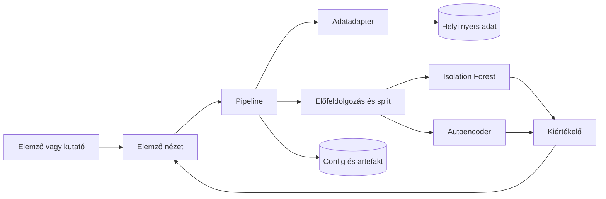

# Hálózati anomáliák felismerése önfelügyelt gépi tanulással

## 1. Szereplők és jogosultságok

| Szerep | Igény | Felelősség / hozzáférés |
| --- | --- | --- |
| Elemző | Látni, mely flow-k kaptak magas anomáliapontszámot, és miért gyanúsak üzemeltetői nyelven | Engedélyezett helyi adathalmaz kiválasztása, futtatás indítása, lista szűrése, export. Nincs hálózati beavatkozás. |
| Kutató / hallgató (Ádám) | Reprodukálható összehasonlítás két módszer között | Split, config, seed, metrikák, Decision Log. A tanítóhalmaz összetételéért ő felel. |
| Témavezető (Tamás STORCZ, a brief szerint) | Módszer és hatókör átláthatósága | Dokumentáció és döntések áttekintése. Runtime jogosultság nincs. A dataset-választás **validálandó vele**. |

Az MVP helyi, egyfelhasználós. Nincs fiók, RBAC, több bérlő.

## 2. Use case-ek és user storyk

### UC-01 — Adathalmaz betöltése és minőségjelentés

- **User story:** Kutatóként helyi flow-táblát töltök be, hogy lássam a sémát, a hiányzó értékeket és az osztályarányt, mielőtt modellt futtatok.
- **Szereplő:** Kutató
- **Előfeltétel:** A fájl a gépen van (`data/raw/`, nem a Git-repóban), és a profil (oszlopnevek, címkeoszlop) ismert.
- **Fő folyamat:**
  1. A szereplő profilt és elérési utat választ.
  2. A rendszer beolvassa a táblát (vagy egy dokumentált mintát, ha a teljes fájl túl nagy az ellenőrzéshez).
  3. A rendszer kiírja a sorok számát, az oszlopokat, a NaN/Inf arányt, a duplikált sorok becslését és a címkeeloszlást.
  4. A szereplő eldönti, hogy az előfeldolgozási profil megfelelő-e.
- **Alternatívák:** Üres fájl, olvashatatlan kódolás vagy hiányzó kötelező oszlop → hard fail, modell nem indul. Ismeretlen extra oszlop → a profil szerint elutasítás vagy figyelmen kívül hagyás, naplózva.
- **Utófeltétel:** Minőségjelentés fájlba vagy képernyőre kerül; nyers adat nem módosul.

### UC-02 — Előfeldolgozás és normal-only split

- **User story:** Kutatóként úgy vágom szét az adatot, hogy a modell csak normál forgalmat lásson tanuláskor, a rendellenes minták pedig csak az értékelésben jelenjenek meg.
- **Szereplő:** Kutató
- **Előfeltétel:** UC-01 jelentés elfogadható; a „normal” címke értéke a profilban rögzített (CIC-IDS2017-nél tipikusan `BENIGN`, ezt a beszerzéskor ellenőrizni kell).
- **Fő folyamat:**
  1. Duplikátum-szabály alkalmazása (jelölés vagy eldobás, naplózva).
  2. Hiányzó, Inf és szélsőséges értékek kezelése a profil szerint.
  3. Ismeretlen kategória → `unknown`, soha nem automatikus `BENIGN`.
  4. Split: elsődlegesen idő vagy flow-csoport; véletlen split csak fallback, és ekkor a kockázat ki van írva.
  5. Skálázó illesztése kizárólag a tanító normál rész statisztikáin.
- **Alternatívák:** A kért tanítóhalmaz támadócímkét tartalmaz → a futás megáll. Nincs elég normál sor → megáll, nem imputálunk címkét.
- **Utófeltétel:** `train_normal`, `val_normal` (küszöbhöz), `test` (kevert, címkézett) halmazok és a skálázó paraméterei elmentve.

### UC-03 — Két detektor tanítása normál forgalmon

- **User story:** Kutatóként ugyanazon a normál tanítóhalmazon futtatok egy Isolation Forest baseline-t és egy autoencoder irányt, hogy összehasonlíthatók legyenek.
- **Szereplő:** Kutató
- **Előfeltétel:** UC-02 kész; configban seed és módszerlista van.
- **Fő folyamat:**
  1. Isolation Forest illesztése a skálázott normál tanítóra.
  2. Autoencoder tanítása ugyanerre (rekonstrukció; a címke nem bemenet).
  3. Mindkét modell artefaktja és a config mentése. Ha a második módszer elbukik, az első eredménye megmarad, a hiba naplózott.
- **Alternatívák:** Memória/idő limit → kisebb subset, kisebb háló, kevesebb epoch. Az autoencoder **nem** cserélhető csendben PCA-ra csak compute miatt; ha a P2-ben az SSL/AE nem tartható, külön Decision Log + témavezetői egyeztetés (ADR-003). OCSVM az IF tartaléka lehet.
- **Utófeltétel:** Legalább a baseline artefakt létezik; a második vagy kész, vagy dokumentáltan tartalékra esett.

### UC-04 — Anomáliapontszám, küszöb, lista

- **User story:** Elemzőként egy rendezett listán látom a gyanús flow-kat pontszámmal, anélkül hogy a rendszer blokkolna bármit a hálózaton.
- **Szereplő:** Elemző
- **Előfeltétel:** Legalább egy betanított modell.
- **Fő folyamat:**
  1. Pontszám minden kiértékelt sorra (nagyobb = gyanúsabb; az irány a módszeren belül rögzített és a UI-n kiírt).
  2. Küszöb: **validáció-alapú** választás a `val_normal` pontszámokon (ADR-004). Előre rögzített percentilis-jelöltek vizsgálata; választási szabály a configban (pl. FPR-cél a val-on). A címkézett **teszt nem** hangolja a küszöböt.
  3. A küszöb feletti sorok listája: azonosító, pontszám, döntés. Ha a módszer engedi, legfeljebb néhány feature hozzájárulás.
- **Alternatívák:** Nincs küszöb feletti sor → üres állapot, nem hiba. Szélsőséges bemenet pontszáma kiszámolható, de külön jelölést kap, ha a preprocess clipelte vagy eldobta.
- **Utófeltétel:** Lista és a használt küszöb exportálható.

### UC-05 — Összehasonlítás azonos protokollon

- **User story:** Kutatóként egy táblában látom a két módszer felismerését, téves riasztását, általánosítását és költségét.
- **Szereplő:** Kutató
- **Előfeltétel:** UC-03 és UC-04 mindkét módszerre, ugyanazzal a splittel és előfeldolgozással. A küszöb már rögzítve van a `val_normal` alapján (ADR-004 / UC-04).
- **Fő folyamat:**
  1. AUROC és PR-AUC (rangsor), TPR rögzített FPR mellett a **teszt** halmazon a rögzített küszöbbel, wall-clock és memória.
  2. **Általánosítás (ha több támadáscsalád van):** egy család / forgatókönyv **holdout** — nem szerepel a tanításban, a modellválasztásban és a küszöb hangolásában. Csak a végső általánosítási riportban jelenik meg.
  3. Ha csak egy család van: a riport „általánosítás: nem alkalmazható” jelzést ad, nem talál ki számot.
- **Utófeltétel:** Összehasonlító tábla + config reprodukálható; a holdout család nem került be a train / val_normal / küszöb lépésbe.

### UC-06 — Hatókörön kívüli kérés elutasítása

- **User story:** Üzemeltetőként nem tudok a prototípussal szabályt írni tűzfalra vagy forgalmat generálni.
- **Szereplő:** Elemző
- **Fő folyamat:** A felületnek nincs „blokkolás”, „izolálás” vagy „támadás indítása” művelete. Ha valaki ilyet kér a dokumentált hatókörön kívül, a válasz: nem része a projektnek.
- **Utófeltétel:** A hálózati eszközök állapota változatlan.

## 3. Funkcionális követelmények

Prioritás: **Kötelező** = az 1. félév specifikációja és a 2. félév MVP-je; **Ajánlott** = fontos, de a kötelező mag nélkül is védhető az első mérési kör; **Lehetséges** = bővítés (online stream, klaszter, magyarázat).

| ID | Követelmény | Elfogadási kritérium | Prioritás |
| --- | --- | --- | --- |
| FR-01 | Támogatott flow-tábla betölthető | Adott érvényes profilnál a rendszer kiírja a sorok és oszlopok számát, és nem módosítja a nyers fájlt | Kötelező |
| FR-02 | Minőségjelentés | A jelentés tartalmazza a NaN arányt, az Inf darabszámot, a duplikált sorok számát és a címkeeloszlást | Kötelező |
| FR-03 | Hibás bemenet megállít | Üres fájl vagy hiányzó címkeoszlop esetén nincs modellillesztés, és a hiba oka egy mondatban látszik | Kötelező |
| FR-04 | Hiányzó érték kezelése | A választott szabály (oszlopeldobás, medián a tanító normálból, vagy sor eldobása) a futás naplójában szerepel, és a medián nem a teszthalmazból származik | Kötelező |
| FR-05 | Inf és extrém érték | Az Inf nem marad csendben a mátrixban: eldobás vagy dokumentált csere; a clip határai a tanító normálból jönnek | Kötelező |
| FR-06 | Ismeretlen kategória | A tanítóban nem látott kategória `unknown` (vagy elutasított sor), és nem kap `BENIGN` címkét | Kötelező |
| FR-07 | Tanítás csak normálon | A tanító mátrixban a támadó/rendellenes címkéjű sorok száma 0; ha nem, a futás elutasít | Kötelező |
| FR-08 | Split nem keveri a skálázást | A skálázó `fit` csak `train_normal`-on fut; a teszt csak `transform` | Kötelező |
| FR-09 | Duplikátumok kezelése | A jelentés megmondja, hány sort érint a duplikátumszabály, és a szabály a configban van | Kötelező |
| FR-10 | Osztályarány látható | A minőségjelentés mutatja a normál és a rendellenes arányt; a modellválasztás nem accuracy-re optimalizál | Kötelező |
| FR-11 | Anomáliapontszám | Minden kiértékelt, preprocessen átment sorhoz véges szám tartozik, nagyobb érték = gyanúsabb | Kötelező |
| FR-12 | Küszöb validációból, naplózott folyamattal | A riport tartalmazza: val-halmaz, vizsgált percentilis-opciók, választott küszöb, választási szabály; a teszten nincs küszöbhangolás (ADR-004) | Kötelező |
| FR-13 | Két módszer | Isolation Forest és autoencoder (vagy naplózott tartalék) ugyanazon a spliten és feature-mátrixon fut | Kötelező |
| FR-14 | Összehasonlító metrikák | A tábla tartalmaz legalább egy rangsor-metrikát (AUROC vagy PR-AUC) és egy tévesriasztási nézetet (FPR vagy TPR@FPR), plusz futásidőt | Kötelező |
| FR-15 | Holdout általánosítás | Ha ≥2 rendellenes család van, legalább egy család **kimarad** a tanításból, a modellválasztásból és a küszöb hangolásából (`val_normal` only); csak a végső általánosítási riportban jelenik meg. Egyetlen család esetén: „nem alkalmazható” | Ajánlott |
| FR-16 | Anomáliák listája | A felület vagy export rendezhető azonosító + pontszám + döntés szerint; üres lista nem hiba | Kötelező |
| FR-17 | Reprodukálhatóság | Seed, csomagverziók és config a futás mellett elmentve; ismételt futtatás ugyanazzal a configgal ugyanazt a döntésirányt adja a baseline-nál, amennyire a könyvtár engedi | Ajánlott |
| FR-18 | Nincs ellenintézkedés | Nincs API vagy gomb, amely tűzfalszabályt, blokkot vagy forgalmat hoz létre | Kötelező |
| FR-19 | Feature hozzájárulás | Ha a módszer ad ilyet, legfeljebb 5 feature látszik egy sor mellett; ha nem, a UI ezt kiírja, nem talál ki magyarázatot | Lehetséges |
| FR-20 | Nagy fájl mintavétel | Teljes CIC-fájl nélkül is lehet sémát ellenőrizni egy dokumentált sorlimittel; a limit a jelentésben szerepel, és nem „teljes benchmark”-ként van kommunikálva | Ajánlott |

## 4. Üzleti szabályok és korlátok

| ID | Szabály vagy korlát | Indoklás |
| --- | --- | --- |
| BR-01 | A tanulás nem használhat rendellenes címkét felügyelt célváltozóként | A brief önfelügyelt / felügyelet nélküli tanulást kér; a címke értékelésre való |
| BR-02 | A címkeoszlop nem lehet feature | Közvetlen szivárgás |
| BR-03 | Azonos flow nem lehet egyszerre tanítóban és tesztben, ha van flow-azonosító | Adatszivárgás |
| BR-04 | Véletlen sor-split csak akkor, ha idő vagy flow-azonosító nincs, és a kockázat ki van írva | A brief a szivárgás kezelését kéri |
| BR-05 | Nincs automatikus blokkolás, izolálás, exploit vagy forgalomgenerálás | Brief határa |
| BR-06 | Nyers benchmark és modellbináris nem kerül a publikus repóba | Méret, licenc, `.gitignore` |
| BR-07 | Ismeretlen címke nem számít normálnak | Címkézési bizonytalanság |
| BR-08 | A küszöb változtatható, és minden riport rögzíti az értékét | FPR és felismerés cseréje |
| BR-09 | Az összehasonlítás azonos előfeldolgozást és splitet használ | Különben a módszer és az adat-előkészítés összekeveredik |
| BR-10 | Mért számot csak lefuttatott kísérletből idézünk | Őszinteség: tervezett ≠ mért |
| BR-11 | Belső, céges forgalom (Bonafarm) nem része az adatnak | Nincs engedélyezett belső dump; a projekt publikus benchmarkra épül |
| BR-12 | A primer adathalmaz a CIC-IDS2017, amíg a témavezető mást nem kér | Brief kiindulás; **validálandó témavezetővel** |

## 5. Szélsőséges és hibautak

| Eset | Elvárt viselkedés |
| --- | --- |
| Üres fájl | FR-03 megállás |
| Csak fejléc | Ugyanaz, mint az üres adat |
| Minden sor támadó a „train” kérésben | Elutasítás (FR-07) |
| NaN egy kötelező numerikus oszlopban | FR-04 szabály, napló |
| `inf` / `-inf` | FR-05 |
| Új kategória tesztidőben | FR-06 `unknown` |
| Oszlopnév eltér a profiltól (szóköz, kis/nagybetű) | Sémahiba, nem csendes átnevezés, kivéve egy dokumentált alias-lista |
| Duplikált fejlécoszlop | Megállás |
| Nagyon ritka támadás (arány < 1%) | A jelentés figyelmeztet; a metrika PR-AUC / TPR@FPR, nem accuracy |
| Egyetlen támadáscsalád | FR-15 „nem alkalmazható” jelzéssel, nem kitalált általánosítási szám |
| Modellfájl hiányzik scoringnál | Hiba, a nyers adat érintetlen |
| A második módszer OOM | Az első módszer eredménye megmarad; kisebb subset / kisebb háló. AE→PCA csak ADR-003 szerinti dokumentált döntés + témavezető |
| Felhasználó blokkolást kér | UC-06 elutasítás |

## 6. Felhasználói felület és munkafolyamat

A fő út lineáris: **Dataset → Preprocess → Run/Compare → Alerts**. Nincs marketing hero. Részletes képernyőváz: [UI wireframe összefoglaló](#61-wireframe-összefoglaló).

1. **Dataset.** Útvonal, profil, ellenőrzés. Eredmény: séma, hiányzás, arány. Hiba: sémaüzenet.
2. **Preprocess.** Lépések és paraméterek (scaler, missing, split). Figyelmeztetés, ha a train nem tiszta normál. Gomb: split előállítása.
3. **Run/Compare.** Módszerválasztó, folyamatjelzés, összehasonlító tábla. Hiba: memória vagy hiányzó artefakt.
4. **Alerts.** Azonosító, pontszám, döntés, opcionális feature-jelölés, minimum pontszám szűrő. Üres állapot szövege: nincs küszöb feletti esemény.

A 2. féléves **tervezett MVP felület: Streamlit**. CLI + exportált tábla csak **tartalék**, ha a Streamlit a kötelező ML pipeline-t (adat → IF + AE/SSL → metrikák) veszélyeztetné. Nem egyenrangú, tetszőleges választás. Ezt a Presentation 2-n ki kell mondani.

### 6.1 Wireframe összefoglaló

1. **Dataset** — helyi útvonal / profil, minőségjelentés, sémahiba.
2. **Preprocess** — lépések, scaler, missing policy, normal-only figyelmeztetés.
3. **Run / Compare** — IF | AE | mindkettő; metrika-tábla; OOM hiba.
4. **Alerts** — id, score, döntés; üres állapot: nincs küszöb feletti esemény.

Navigáció: Dataset → Preprocess → Run → Alerts.

## 7. Nem funkcionális követelmények

| ID | Követelmény | Ellenőrzés |
| --- | --- | --- |
| NFR-01 | A baseline (Isolation Forest) egy dokumentált, legfeljebb néhány százezer soros subseten CPU-n lefut anélkül, hogy a gép tartósan használhatatlan lenne | Futtatás naplója (idő, gép). Cél, nem vállalt SLA. A szintetikus POC ezt már tudja; CIC-subset még nincs mérve. |
| NFR-02 | Hibás futás nem írja felül a korábbi modellartefaktot | Negatív teszt: hiányzó oszlop után a régi fájl időbélyege változatlan |
| NFR-03 | Függőségek fájlban (`poc/requirements.txt`, később a projekt gyökerében) | Tiszta környezetben telepíthető a POC |
| NFR-04 | Céges és személyes forgalom nem kerül a repóba | `.gitignore` + review |
| NFR-05 | A pontszám iránya a riportban egy mondatban szerepel | Dokumentum-ellenőrzés |
| NFR-06 | A felület billentyűzettel elérhető vezérlőket használ (Streamlit alap), és a táblázat nem csak színnel közli a döntést | Kézi ellenőrzés, ha az UI elkészül |
| NFR-07 | Verziókezelt config és Decision Log | Git történet a hivatalos fázisban |

## 8. ML munkafolyamat

1. Profil és nyers tábla.
2. Minőségjelentés (FR-02).
3. Tisztítás (FR-04, FR-05, FR-06, FR-09).
4. Címke levétele a feature-ökből (BR-02).
5. `train_normal` / `val_normal` / `test` (FR-07, FR-08).
6. Isolation Forest illesztés; pontszám = a sklearn „normal score” előjele megfordítva, hogy a nagyobb legyen a gyanús. Ezt a POC így csinálja.
7. Autoencoder: csak normál rekonstrukció; pontszám = rekonstrukciós hiba. Hiperparaméterek (rétegek, epoch, learning rate) a configban, alapértelmezés kis háló és kevés epoch a CPU miatt.
8. Küszöb: ADR-004 szerint — `val_normal` jelöltek vizsgálata, rögzített választási szabály, config + riport; teszt csak kiértékel.
9. Teszt metrikák címkével, a címke nélkül a modellben (FR-14).
10. **Holdout általánosítás (FR-15):** ha ≥2 támadáscsalád van, egy család kimarad a train / modellválasztás / küszöb lépésből; csak a végső általánosítási riportban jelenik meg.
11. Artefakt + config + rövid riport.

**Választás indoklása (terv, nem mért győztes):** Isolation Forest = olcsó baseline; Autoencoder = brief szerinti önfelügyelt reprezentáció (második **fő** módszer). PCA nem alapértelmezett helyettesítő (ADR-003).

## 9. Kezdeti technikai javaslat

### Javasolt megoldás

Python kísérleti pipeline: adatadapter, előfeldolgozás, két detektor, kiértékelő, elemző nézet. A nyers adat a gépen marad. A Git a kódot, a config sémát, a dokumentációt és a kis szintetikus POC-t viszi.

### Technológiai irány

| Terület | Jelölt | Miért | Nyitott pont |
| --- | --- | --- | --- |
| Nyelv | Python 3.11+ | sklearn és a későbbi PyTorch | A Bonbon gépen a POC Python 3.14-gyel futott; a CI-terv 3.11 |
| Baseline | Isolation Forest (scikit-learn) | Gyors, kevés paraméter, a POC ezen ellenőrizhető | Küszöb és `contamination` szerepe külön magyarázandó: a döntés a validációs percentilis, nem a contamination címke |
| Reprezentáció | Kis autoencoder (PyTorch) — **második fő módszer** | Önfelügyelt rekonstrukció | PCA csak dokumentált tartalék + témavezető, nem csendes csere |
| Tábla | pandas a mintára; parquet, ha a subset már stabil | Gyakorlat | Teljes CIC nem fér bele gondatlanul a memóriába |
| UI | Streamlit (tervezett MVP) | Egy folyamat, gyors demó | CLI + export csak ha Streamlit a ML pipeline-t veszélyeztetné |
| CI | GitHub Actions POC-teszt (terv) | Push kapu zárva | Éles workflow csak LIVE_GITHUB után |

### Architektúra

### Megvalósíthatóság

| Feltételezés | Ellenőrzés a 2. félévben | Tartalék |
| --- | --- | --- |
| Az Isolation Forest a választott feature-ökön stabil pontszámot ad | Subset futtatás, seed ismétlés | One-Class SVM |
| Az autoencoder CPU-n vállalható egy subseten | Epoch, sorlimit, kis háló | Dokumentált SSL-tartalék döntés + témavezető (nem csendes PCA) |
| A CIC-IDS2017 minősége kezelhető | Minőségjelentés a beszerzés után | Tisztított subset; ha a témavezető kéri, UNSW-NB15 |
| A Streamlit elég a kurzusnak | Egy képernyős prototípus | CLI + export tartalék, ha Streamlit a kötelező ML-t veszélyeztetné |

## 10. Döntési hivatkozások (hivatalos)

| ADR | Tárgy |
| --- | --- |
| ADR-003 (helyi Decision Log: detector pair) | Isolation Forest + Autoencoder/SSL (PCA csak dokumentált tartalék) |
| ADR-004 (helyi Decision Log: validation threshold) | Validáció-alapú küszöbválasztás |

## 11. Nyitott kérdések és kockázatok

A részletes regiszter helyi (nem a publikus repó része). Itt a specifikációban rögzített, még nem lezárt pontok:

| Kérdés | Hatás | Felelős | Állapot |
| --- | --- | --- | --- |
| CIC-IDS2017 marad-e a primer halmaz? | Minden további adatjegyzőkönyv | Ádám + témavezető | **Validálandó témavezetővel** (ADR-002) |
| A témavezető neve a kiosztáskor megegyezik-e a brieffel? | Frontmatter | Ádám | Brief szerint Tamás STORCZ; **kiosztási megerősítés még szükséges**, ha nincs külön ellenőrizve |
| Trello URL | Outline frontmatter | Ádám, manuális | Nincs URL |
| PyTorch AE tartható-e a P2 első körében? | Idő/compute | Ádám + témavezető | ADR-003: nem csendes PCA |
| Küszöb választási szabály (FPR-cél a val-on) | FPR trade-off | Ádám | ADR-004 folyamat; nem „tippelt 95/99” |

A projekt **elfogadva** (`accepted=true`); a terv **helyben jóváhagyva**. Ami nyitott: témavezetői CIC-megerősítés, Trello URL, kiosztási megerősítés a témavezető nevére (ha még nincs), push csak külön engedéllyel.

## 12. Audit a kurzusmintához és a briefhez

A minta szekciói (szereplők, use case, FR+AC+prioritás, üzleti szabályok, UI, NFR, nyitott kérdések, technikai javaslat, technológiai tábla, Mermaid, megvalósíthatóság) megvannak. A brief többlete (két módszer, pontszám, megjelenítés, hiányzó/ismeretlen/szélsőséges bemenet, benchmark, szétválasztott protokoll, duplikáció, szivárgás, aránytalanság, általánosítás, számítási igény, eloszlásváltozás és címkézési bizonytalanság) a FR/BR sorokban és a kockázati regiszterben szerepel. Támadásvégrehajtás és automatikus ellenintézkedés kizárva (BR-05, FR-18, UC-06).

A traceability mátrix helyi (nem a publikus repó része).
