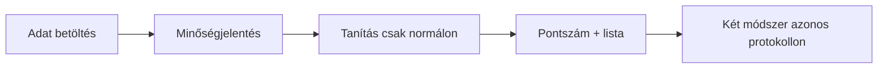

> Az 1. félév első kötelező prezentációja. PRMD / PowerMD forrás; a beszéd saját szavakkal történik, nem felolvasás.

<!-- 5xl -->
# Hálózati anomáliák felismerése önfelügyelt gépi tanulással

Szerző: Horváth Ádám  
Neptun: DJLZI4  
Témavezető (projektbrief szerint): Tamás STORCZ  
Projektazonosító: 2026-ST-02  

<!-- @note -->
> Egy mondat: normál forgalomból tanuló anomáliadetektálás, pontszámmal, két módszerrel. Nem IDS-blokk.

---

<!-- 2xl -->
[prmd.atom-forge.eu/docs](https://prmd.atom-forge.eu/docs)

---

## Probléma

<!-- xl -->
Szokatlan hálózati mintázatok hibára, konfigurációra vagy más rendellenességre utalhatnak.

<!-- md -->
Nem minden esethez van címkézett támadóminta.  
A kérdés: mennyire tér el a flow a **normál** forgalomtól?

<!-- @note -->
> A címke a méréshez kell — nem a train célváltozója. Ne ígérj nulladik napi védelmet.

---

## Célfelhasználók

<!-- lg -->
- **Elemző** — pontszámos lista áttekintése  
- **Kutató / hallgató** — két módszer összehasonlítása  
- **Témavezető** — módszertan átláthatósága  

<!-- @note -->
> Nincs többfelhasználós portál. Bonafarm = motiváció, nem adatforrás és nem ügyfélígéret.

---

## Tervezett hatókör

<!-- lg -->
**Benne:** benchmark adat · előfeldolgozás · ≥2 módszer · metrikák · elemző UI

<!-- md -->
**Kívül:** támadásvégrehajtás · aktív behatolás · automatikus ellenintézkedés

<!-- @note -->
> Ha kérdeznek FortiGate / blokkolás / exploit: UC-06 — hatókörön kívül.

---

## Mérhető sikerkritériumok

<!-- md -->
1. Dokumentált adatbeszerzés + minőségvizsgálat  
2. Tanítás csak normál forgalmon; értékelés elkülönítve  
3. ≥2 módszer azonos protokollon  
4. Metrikák: FPR-jelleg, felismerés, AUROC/AUPRC (ha van címke)  
5. Anomáliák listája pontszámmal (UI)

<!-- sm -->
Célok — még nincsenek CIC-mérések

<!-- @note -->
> Tervezett ≠ mért. Ne mondj ki CIC százalékot.

---

## Fő funkcionális képességek

<!-- md -->
- Flow-tábla betöltés + minőségjelentés  
- Előfeldolgozás; normal-only train / val / test  
- Isolation Forest + Autoencoder/SSL pontszám  
- Validáció-alapú küszöb; rendezhető anomália-lista  
- Összehasonlító metrikák (holdout, ha van ≥2 család)

<!-- @note -->
> Rövid lista — nem full spec. Részletek a specifikációban.

---

## Két módszer (irány)

<!-- lg -->
1. **Isolation Forest** — felügyelet nélküli baseline  
2. **Autoencoder / SSL** — második **fő** módszer (reprezentáció)

<!-- sm -->
PCA nem csendes helyettesítő · győztes csak mérés után

<!-- @note -->
> Ne tarts IF/PyTorch előadást. Irány + miért két módszer.

---

## Kezdeti felhasználói utak

<!-- md -->
1. Adat betöltése → minőségjelentés  
2. Tanítás **csak normál** forgalmon → pontszám → lista  
3. Két módszer azonos protokollon  

<!-- @note -->
> Üres lista nem hiba. Hibás fájl → modell nem indul.

---

## Adat (előzetes)

<!-- lg -->
Kiindulás: **CIC-IDS2017** — validálandó témavezetővel

<!-- sm -->
Nincs idézett CIC-teljesítmény az 1. félévben

<!-- @note -->
> NSL-KDD = füstteszt, nem eredmény. Subset, nem teljes corpus ígéret.

---

## Következő lépések

<!-- md -->
Specifikáció: **kész** (GitHub) · Decision Log · Presentation 2 · Trello board URL  
2. félév: működő, kiértékelhető prototípus

<!-- @note -->
> P1 = funkcionális terv. Technikai mélység = Presentation 2.
