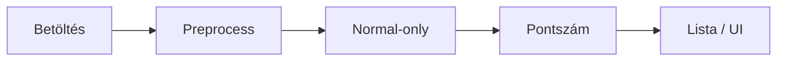
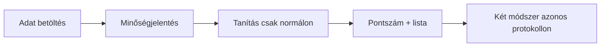
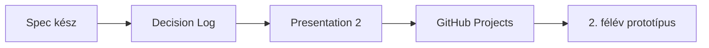

> Az 1. félév első kötelező prezentációja. PRMD / PowerMD forrás; a beszéd saját szavakkal történik, nem felolvasás.

<!-- @slide Cím -->
<!-- @slide-theme slate cyan zinc -->
<!-- @set-align center -->
<!-- @set-width 88% -->

<!-- @scale 125% -->
# Hálózati anomáliák felismerése önfelügyelt gépi tanulással

<!-- @gap 2 -->

Horváth Ádám · DJLZI4  
Témavezető (projektbrief szerint): Tamás STORCZ  
Projektazonosító: **2026-ST-02**

<!-- @gap 1 -->

Normál forgalomból tanuló rendszer · pontszám és lista · nem blokkoló IDS

<!-- @note -->
> **FŐ MONDAT:** Normál forgalomból tanuló anomáliadetektálás; kimenet pontszám és lista.
> **MONDD EL:** Ki vagy, mi a projekt, brief szerinti témavezető. 1. félév = funkcionális terv.
> **FOGALMAK:** *Anomália* = a normáltól eltérő minta (≠ támadásosztály). *Score* = soronkénti gyanúszám (nagyobb = gyanúsabb).
> **FIGYELJ:** Ne ígérj blokkolást vagy éles SOC-ot.

---

<!-- @slide Docs -->
<!-- @slide-theme slate cyan zinc -->
<!-- @set-align center -->

<!-- @scale 140% -->
[prmd.atom-forge.eu/docs](https://prmd.atom-forge.eu/docs)

<!-- @note -->
> **FŐ MONDAT:** Kurzus PRMD / PowerMD docs — átugorható.
> **MONDD EL:** Egy mondat, ha kell: ez a formátum referenciája.
> **FOGALMAK:** —
> **FIGYELJ:** Ne olvass fel semmit. Forrás: GitHub `03-presentation-1.md`.

---

<!-- @slide Probléma -->
<!-- @slide-theme slate cyan zinc -->
<!-- @layout AB -->

<!-- @set-align left -->
<!-- @set-width 92% -->

## Probléma

<!-- @gap 1 -->

Szokatlan hálózati mintázatok hibára, konfigurációra vagy más rendellenességre utalhatnak.

A cél: rendszer, amely a **normál** forgalomból tanul, és jelzi az eltérést.

***

<!-- @set-align left -->
<!-- @bg slate-900/25 -->

### A kérdés

Nem minden esethez van címkézett támadóminta.

Mennyire tér el a **flow** a megszokott forgalomtól?

<!-- @note -->
> **FŐ MONDAT:** A kérdés a normáltól való eltérés — nem mindenre van címke.
> **MONDD EL:** Címke a méréshez kell, nem a train célváltozója. Anomália ≠ támadás.
> **FOGALMAK:** *Flow* = egy kapcsolat / forgalmi sor jellemzőkkel. *Anomália* = eltérés a normáltól, nem automatikusan „támadás”.
> **FIGYELJ:** Ne ígérj nulladik napi védelmet.

---

<!-- @slide Célfelhasználók -->
<!-- @slide-theme slate cyan zinc -->
<!-- @layout AAA/BCD -->

<!-- @set-align center -->

## Célfelhasználók

***

<!-- @bg slate-900/20 -->
<!-- @set-align center -->

### Elemző

Pontszámos listát néz át.  
Nincs hálózati beavatkozás.

***

<!-- @bg slate-900/20 -->
<!-- @set-align center -->

### Kutató / hallgató

Két módszert hasonlít össze  
azonos protokollon.

***

<!-- @bg slate-900/20 -->
<!-- @set-align center -->

### Témavezető

Módszertan és hatókör  
átláthatóságát ellenőrzi.

<!-- @note -->
> **FŐ MONDAT:** Elemző lista · te összehasonlítasz · témavezető a módszert nézi.
> **MONDD EL:** Nincs többfelhasználós portál. Bonafarm = motiváció, nem adatforrás.
> **FOGALMAK:** *Streamlit* = tervezett MVP UI a listához (2. félév); CLI+export csak tartalék.
> **FIGYELJ:** SOC éles használat nem az 1. félév ígérete.

---

<!-- @slide Hatókör -->
<!-- @slide-theme slate cyan zinc -->
<!-- @layout AA/BC -->

<!-- @set-align left -->

## Tervezett hatókör

***

<!-- @bg emerald-950/30 -->
<!-- @set-align left -->

### Benne

- Publikus **benchmark** adat  
- Előfeldolgozás + normal-only tanítás  
- ≥2 felügyelet nélküli / SSL módszer  
- Metrikák + elemző UI  

***

<!-- @bg rose-950/25 -->
<!-- @set-align left -->

### Kívül

- Támadásvégrehajtás  
- Aktív behatolás / exploit  
- Automatikus ellenintézkedés  

<!-- @note -->
> **FŐ MONDAT:** Benne: adat → modellek → metrika → UI. Kívül: támadás / exploit / auto-mitigation.
> **MONDD EL:** Hangosan a „kívül” sort. UC-06 — hatókörön kívül.
> **FOGALMAK:** *Unsupervised* = nincs támadáscímke a tanuláskor. *SSL* = a feladat az adatból jön (pl. rekonstrukció), nem a támadásnév.
> **FIGYELJ:** FortiGate / blokkolás / exploit → nem.

---

<!-- @slide Sikerkritériumok -->
<!-- @slide-theme slate cyan zinc -->
<!-- @set-align left -->
<!-- @set-width 88% -->

## Mérhető sikerkritériumok

<!-- @gap 1 -->

1. Dokumentált adatbeszerzés + minőségvizsgálat  
2. Tanítás **csak normál** forgalmon; értékelés elkülönítve  
3. ≥2 módszer azonos protokollon  
4. FPR-jelleg, felismerés, AUROC / PR-AUC (ha van címke)  
5. Anomáliák listája pontszámmal (UI)

<!-- @gap 1 -->

<!-- @callout tip -->
> **Célok** — még nincsenek CIC-mérések · tervezett ≠ mért

<!-- @note -->
> **FŐ MONDAT:** Öt mérhető cél — tervezett, nem mért.
> **MONDD EL:** Tervezett ≠ mért. Ne mondj CIC százalékot.
> **FOGALMAK:** *FP* = normál, amit riasztunk. *FPR* = normálak hány %-a riasztás. *TPR* = rendellenesek hány %-át találjuk. *AUROC* / *PR-AUC* = rangsor-metrikák címkézett teszten (PR-AUC őszintébb ritka osztálynál).
> **FIGYELJ:** Számok a 2. félév mérései után.

---

<!-- @slide Képességek -->
<!-- @slide-theme slate cyan zinc -->
<!-- @layout A/BC -->

<!-- @set-align left -->

## Fő funkcionális képességek

***

<!-- @set-align left -->
<!-- @set-width 94% -->

- Flow-tábla betöltés + minőségjelentés  
- Normal-only train / val / test; skálázó csak trainen  
- IF + AE/SSL pontszám; validáció-alapú küszöb  
- Rendezhető lista; összehasonlító metrikák (+ holdout)

***

<!-- @bg slate-900/25 -->
<!-- @set-align center -->
<!-- @contain -->

<!-- @note -->
> **FŐ MONDAT:** Betöltés → normal-only → két pontszám → lista.
> **MONDD EL:** Rövid lista — részletek a specifikációban.
> **FOGALMAK:** *Normal-only* = trainen csak normál. *Val* = küszöbhöz (csak normál). *Test* = kevert mérés. *Threshold* = vágás a pontszámon; teszten nem tekerjük. *Holdout* = család kimarad train/val/küszöbből; csak végső riport.
> **FIGYELJ:** Leakage = teszt/címke info a tanulásban vagy skálázóban.

---

<!-- @slide Két módszer -->
<!-- @slide-theme slate cyan zinc -->
<!-- @layout AA/BC -->

<!-- @set-align left -->

## Két módszer (irány)

<!-- @callout warning -->
> PCA nem csendes helyettesítő · győztes csak mérés után

***

<!-- @bg slate-900/25 -->
<!-- @set-align left -->

### 1 · Isolation Forest

Felügyelet nélküli **baseline**.  
Ritka pontokat választja le gyorsan.

***

<!-- @bg cyan-950/30 -->
<!-- @set-align left -->

### 2 · Autoencoder / SSL

Második **fő** módszer.  
Normál rekonstrukció; nagy hiba = gyanú.

<!-- @note -->
> **FŐ MONDAT:** IF baseline + AE/SSL fő irány — győztes csak mérés után.
> **MONDD EL:** Miért kettő: összehasonlítható protokoll. Ne tarts PyTorch előadást.
> **FOGALMAK:** *IF* = fa-alapú, unsupervised baseline. *AE* = összenyomja és visszaépíti a sort; hiba = score. *SSL* = önfelügyelt cél (saját bemenet), nem támadáscímke.
> **FIGYELJ:** AE nem „biztosan jobb”. PCA csak dokumentált tartalék + témavezető.

---

<!-- @slide Felhasználói utak -->
<!-- @slide-theme slate cyan zinc -->
<!-- @layout A/BC -->

<!-- @set-align left -->

## Kezdeti felhasználói utak

***

<!-- @contain -->
<!-- @set-align center -->

***

<!-- @set-align left -->
<!-- @bg slate-900/20 -->

1. Adat betöltése → minőségjelentés  
2. Tanítás **csak normál** forgalmon → pontszám → lista  
3. Két módszer azonos protokollon  

<!-- @note -->
> **FŐ MONDAT:** Load → minőség → normal-only → pontszám/lista → összehasonlítás.
> **MONDD EL:** Mutasd a Mermaid nyilat. Üres lista nem hiba.
> **FOGALMAK:** *Leakage* = a modell/skálázó tesztből vagy címkéből tanul. *Normal-only* = a rendellenes nem cél a trainben.
> **FIGYELJ:** Nincs auto-mitigation a journey végén. Hibás fájl → modell nem indul.

---

<!-- @slide Adat -->
<!-- @slide-theme slate cyan zinc -->
<!-- @layout AA/BC -->

<!-- @set-align left -->

## Adat (előzetes)

***

<!-- @set-align center -->
<!-- @bg slate-900/25 -->

### Kiindulás

**CIC-IDS2017**

publikus benchmark ·  
validálandó témavezetővel

***

<!-- @set-align left -->
<!-- @bg amber-950/25 -->

### Korlátok

- Nincs idézett CIC-teljesítmény  
- Subset — nem teljes corpus ígéret  
- NSL-KDD = füstteszt, nem eredmény  
- Eloszlásváltás / aránytalanság / címkezaj  

<!-- @note -->
> **FŐ MONDAT:** CIC-IDS2017 javasolt; témavezetővel validálandó.
> **MONDD EL:** Előzetes döntés — nem lezárt. Nincs CIC % a P1-en.
> **FOGALMAK:** *Benchmark* = publikus, címkézett referenciaadat. *CIC-IDS2017* = kiindulás (UNB CIC). *Distribution shift* = más hálózat ≠ labor. *Imbalance* = kevés támadás → accuracy csalóka. *Label noise* = címke bizonytalan.
> **FIGYELJ:** NSL smoke ≠ projektadat. Bonafarmra nem húzzuk rá kész tényként.

---

<!-- @slide Következő lépések -->
<!-- @slide-theme slate cyan zinc -->
<!-- @set-align left -->
<!-- @set-width 88% -->

## Következő lépések / roadmap

<!-- @gap 1 -->

<!-- @gap 1 -->

- Specifikáció: **kész** (GitHub)  
- Decision Log · Presentation 2 (technikai mélység)  
- Feladatkövetés: **GitHub Projects** (nem Trello)  
- 2. félév: működő, kiértékelhető prototípus  

<!-- @note -->
> **FŐ MONDAT:** P1 = funkcionális terv. Tech = Presentation 2. Követés: GitHub Projects.
> **MONDD EL:** Spec már fent; következő a tech dia és a prototípus.
> **FOGALMAK:** *Holdout* / metrikák mélyebben = P2. *Streamlit* MVP a 2. félév UI-ja.
> **FIGYELJ:** Trello nem a hivatalos board nálunk. Projects URL OPEN — ne inventálj linket.
