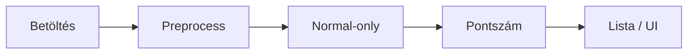
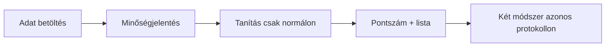
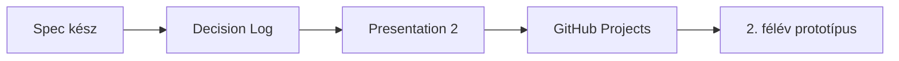

> Az 1. félév első kötelező prezentációja. PRMD / PowerMD forrás; a beszéd saját szavakkal történik, nem felolvasás.

<!-- @slide Cím -->
<!-- @slide-theme slate cyan zinc -->
<!-- @set-align center -->
<!-- @set-width 88% -->

<!-- @scale 130% -->
# Hálózati anomáliák felismerése önfelügyelt gépi tanulással

<!-- @gap 2 -->

Horváth Ádám · DJLZI4  
Témavezető (projektbrief szerint): Tamás STORCZ  
Projektazonosító: **2026-ST-02**

<!-- @note -->
> **FŐ MONDAT:** Normál forgalomból tanuló anomáliadetektálás, pontszámmal, két módszerrel.
> **Mondd el:** Ki vagy, mi a projekt, brief szerinti témavezető.
> **Fontos:** Nem IDS-blokk — kimenet lista, nem szabály.
> **Ha kérdeznek:** 1. félév = funkcionális terv; prototípus a 2. félév.

---

<!-- @slide Docs -->
<!-- @slide-theme slate cyan zinc -->
<!-- @set-align center -->

<!-- @scale 140% -->
[prmd.atom-forge.eu/docs](https://prmd.atom-forge.eu/docs)

<!-- @note -->
> **FŐ MONDAT:** Kurzus PRMD / PowerMD docs — átugorható.
> **Mondd el:** Egy mondat, ha kell: ez a formátum referenciája.
> **Fontos:** Ne olvass fel semmit innen.
> **Ha kérdeznek:** Forrás a GitHub `03-presentation-1.md`.

---

<!-- @slide Probléma -->
<!-- @slide-theme slate cyan zinc -->
<!-- @layout AB -->

<!-- @set-align left -->
<!-- @set-width 92% -->

## Probléma

<!-- @gap 1 -->

Szokatlan hálózati mintázatok hibára, konfigurációra vagy más rendellenességre utalhatnak.

***

<!-- @set-align left -->
<!-- @bg slate-900/25 -->

### A kérdés

Nem minden esethez van címkézett támadóminta.

Mennyire tér el a flow a **normál** forgalomtól?

<!-- @note -->
> **FŐ MONDAT:** A kérdés a normáltól való eltérés — nem mindenre van címke.
> **Mondd el:** Címke a méréshez kell, nem a train célváltozója.
> **Fontos:** Ne ígérj nulladik napi védelmet.
> **Ha kérdeznek:** Nem felügyelt osztályozó; anomáliapontszám.

---

<!-- @slide Célfelhasználók -->
<!-- @slide-theme slate cyan zinc -->
<!-- @layout AAA/BCD -->

<!-- @set-align center -->

## Célfelhasználók

***

<!-- @bg slate-900/20 -->
<!-- @set-align center -->

### Elemző

Pontszámos lista áttekintése

***

<!-- @bg slate-900/20 -->
<!-- @set-align center -->

### Kutató / hallgató

Két módszer összehasonlítása

***

<!-- @bg slate-900/20 -->
<!-- @set-align center -->

### Témavezető

Módszertan átláthatósága

<!-- @note -->
> **FŐ MONDAT:** Elemző lista · te összehasonlítasz · témavezető a módszert nézi.
> **Mondd el:** Nincs többfelhasználós portál.
> **Fontos:** Bonafarm = motiváció, nem adatforrás / ügyfélígéret.
> **Ha kérdeznek:** SOC éles használat nem az 1. félév ígérete.

---

<!-- @slide Hatókör -->
<!-- @slide-theme slate cyan zinc -->
<!-- @layout AA/BC -->

<!-- @set-align left -->

## Tervezett hatókör

***

<!-- @bg emerald-950/30 -->
<!-- @set-align left -->

### Benne

- Benchmark adat  
- Előfeldolgozás  
- ≥2 módszer  
- Metrikák  
- Elemző UI  

***

<!-- @bg rose-950/25 -->
<!-- @set-align left -->

### Kívül

- Támadásvégrehajtás  
- Aktív behatolás  
- Automatikus ellenintézkedés  

<!-- @note -->
> **FŐ MONDAT:** Benne: adat → modellek → metrika → UI. Kívül: támadás / exploit / auto-mitigation.
> **Mondd el:** Hangosan a „kívül” sort.
> **Fontos:** UC-06 — hatókörön kívül.
> **Ha kérdeznek:** FortiGate / blokkolás / exploit → nem.

---

<!-- @slide Sikerkritériumok -->
<!-- @slide-theme slate cyan zinc -->
<!-- @set-align left -->
<!-- @set-width 85% -->

## Mérhető sikerkritériumok

<!-- @gap 1 -->

1. Dokumentált adatbeszerzés + minőségvizsgálat  
2. Tanítás csak normál forgalmon; értékelés elkülönítve  
3. ≥2 módszer azonos protokollon  
4. Metrikák: FPR-jelleg, felismerés, AUROC/AUPRC (ha van címke)  
5. Anomáliák listája pontszámmal (UI)

<!-- @gap 2 -->

<!-- @callout tip -->
> **Célok** — még nincsenek CIC-mérések

<!-- @note -->
> **FŐ MONDAT:** Öt mérhető cél — tervezett, nem mért.
> **Mondd el:** Tervezett ≠ mért.
> **Fontos:** Ne mondj ki CIC százalékot.
> **Ha kérdeznek:** Számok a 2. félév mérései után.

---

<!-- @slide Képességek -->
<!-- @slide-theme slate cyan zinc -->
<!-- @layout A/BC -->

<!-- @set-align left -->

## Fő funkcionális képességek

***

<!-- @set-align left -->
<!-- @set-width 92% -->
<!-- @set-scale 90% -->

- Flow-tábla betöltés + minőségjelentés  
- Előfeldolgozás; normal-only train / val / test  
- Isolation Forest + Autoencoder/SSL pontszám  
- Validáció-alapú küszöb; rendezhető anomália-lista  
- Összehasonlító metrikák (holdout, ha van ≥2 család)

***

<!-- @bg slate-900/25 -->
<!-- @set-align center -->
<!-- @contain -->

<!-- @note -->
> **FŐ MONDAT:** Betöltés → normal-only → két pontszám → lista.
> **Mondd el:** Rövid lista — nem full spec.
> **Fontos:** Részletek a specifikációban.
> **Ha kérdeznek:** Holdout / küszöb mélyebben = P2 / ADR.

---

<!-- @slide Két módszer -->
<!-- @slide-theme slate cyan zinc -->
<!-- @layout AA/BC -->

<!-- @set-align left -->

## Két módszer (irány)

<!-- @callout warning -->
> PCA nem csendes helyettesítő · győztes csak mérés után

***

<!-- @bg slate-900/25 -->
<!-- @set-align left -->

### 1 · Isolation Forest

Felügyelet nélküli **baseline**  
Gyors összehasonlítási vonal

***

<!-- @bg cyan-950/30 -->
<!-- @set-align left -->

### 2 · Autoencoder / SSL

Második **fő** módszer  
Reprezentáció / rekonstrukció

<!-- @note -->
> **FŐ MONDAT:** IF baseline + AE/SSL fő irány — győztes csak mérés után.
> **Mondd el:** Miért két módszer: összehasonlítható protokoll.
> **Fontos:** Ne tarts IF / PyTorch előadást.
> **Ha kérdeznek:** PCA csak dokumentált tartalék + témavezető.

---

<!-- @slide Felhasználói utak -->
<!-- @slide-theme slate cyan zinc -->
<!-- @layout A/BC -->

<!-- @set-align left -->

## Kezdeti felhasználói utak

***

<!-- @contain -->
<!-- @set-align center -->

***

<!-- @set-align left -->
<!-- @bg slate-900/20 -->

1. Adat betöltése → minőségjelentés  
2. Tanítás **csak normál** forgalmon → pontszám → lista  
3. Két módszer azonos protokollon  

<!-- @note -->
> **FŐ MONDAT:** Load → minőség → normal-only → pontszám/lista → összehasonlítás.
> **Mondd el:** Mutasd a Mermaid nyilat.
> **Fontos:** Üres lista nem hiba. Hibás fájl → modell nem indul.
> **Ha kérdeznek:** Nincs auto-mitigation a journey végén.

---

<!-- @slide Adat -->
<!-- @slide-theme slate cyan zinc -->
<!-- @layout AA/BC -->

<!-- @set-align left -->

## Adat (előzetes)

***

<!-- @set-align center -->
<!-- @bg slate-900/25 -->

### Kiindulás

**CIC-IDS2017**

validálandó témavezetővel

***

<!-- @set-align left -->
<!-- @bg amber-950/25 -->

### Korlátok

- Nincs idézett CIC-teljesítmény az 1. félévben  
- Subset — nem teljes corpus ígéret  
- NSL-KDD = füstteszt, nem eredmény  

<!-- @note -->
> **FŐ MONDAT:** CIC-IDS2017 javasolt; témavezetővel validálandó.
> **Mondd el:** Előzetes döntés — nem lezárt.
> **Fontos:** Nincs CIC százalék a P1-en.
> **Ha kérdeznek:** NSL smoke ≠ projektadat.

---

<!-- @slide Következő lépések -->
<!-- @slide-theme slate cyan zinc -->
<!-- @set-align left -->
<!-- @set-width 88% -->

## Következő lépések / roadmap

<!-- @gap 1 -->

<!-- @gap 2 -->

- Specifikáció: **kész** (GitHub)  
- Decision Log · Presentation 2 (technikai mélység)  
- Feladatkövetés: **GitHub Projects** (nem Trello)  
- 2. félév: működő, kiértékelhető prototípus  

<!-- @note -->
> **FŐ MONDAT:** P1 = funkcionális terv. Tech = Presentation 2. Követés: GitHub Projects.
> **Mondd el:** Spec már fent; következő a tech dia és a prototípus.
> **Fontos:** Trello nem a hivatalos kurzusboard nálunk — GitHub Projects.
> **Ha kérdeznek:** Projects URL még manuális / OPEN — nem inventálok linket.
